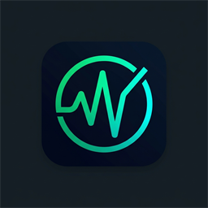
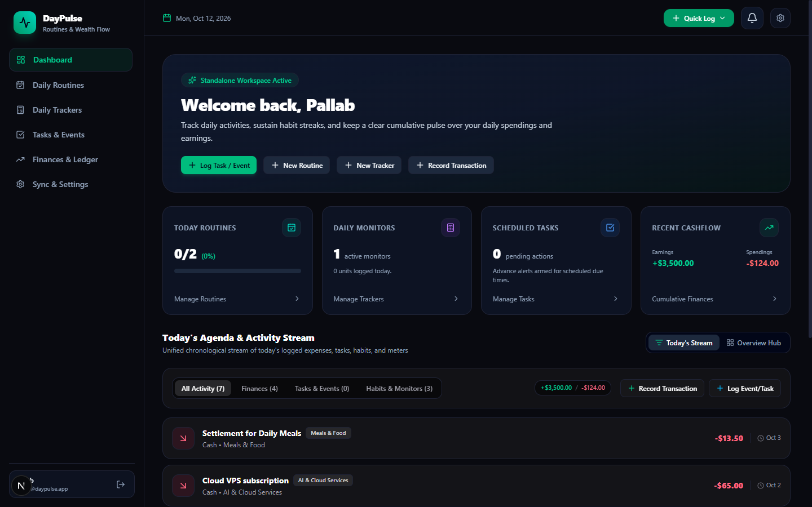
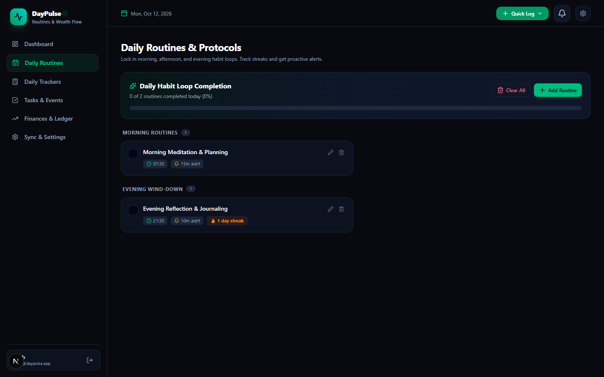
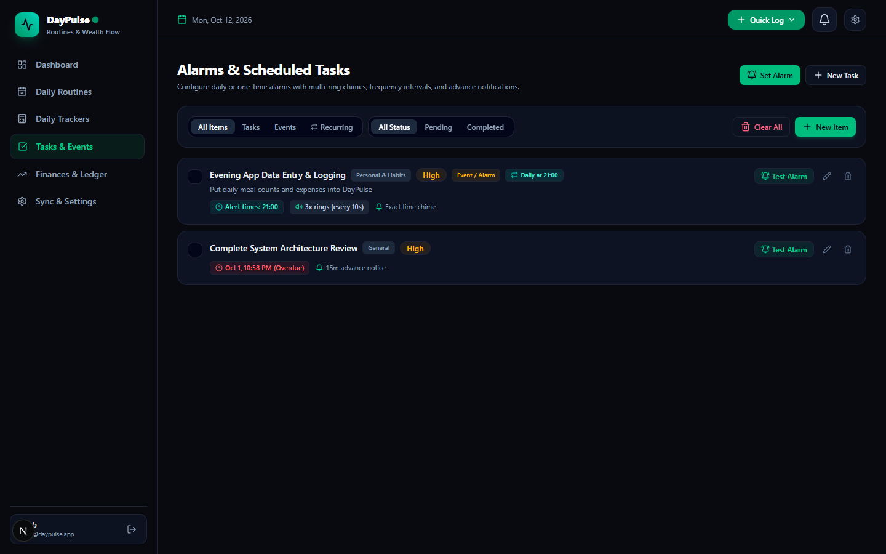
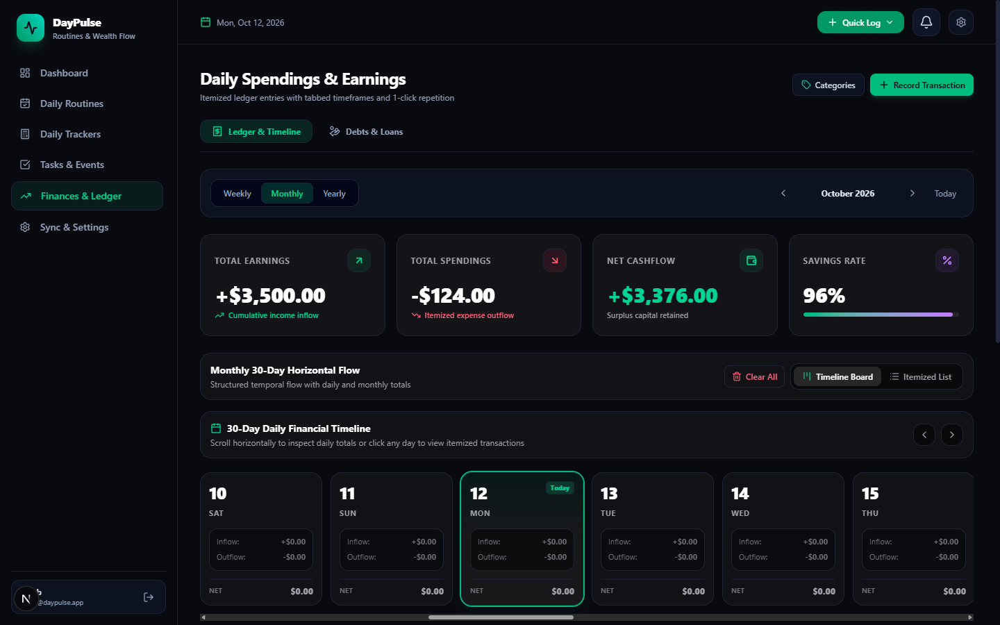
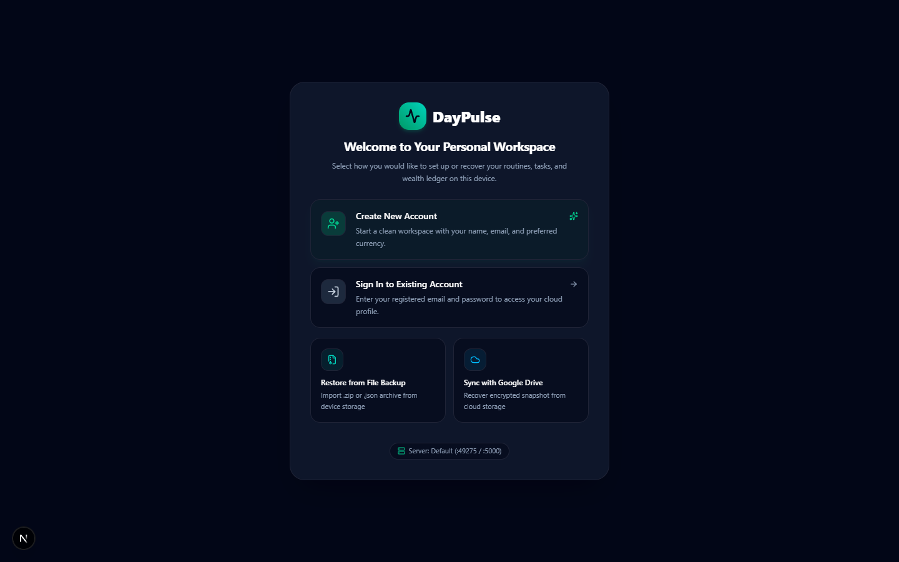
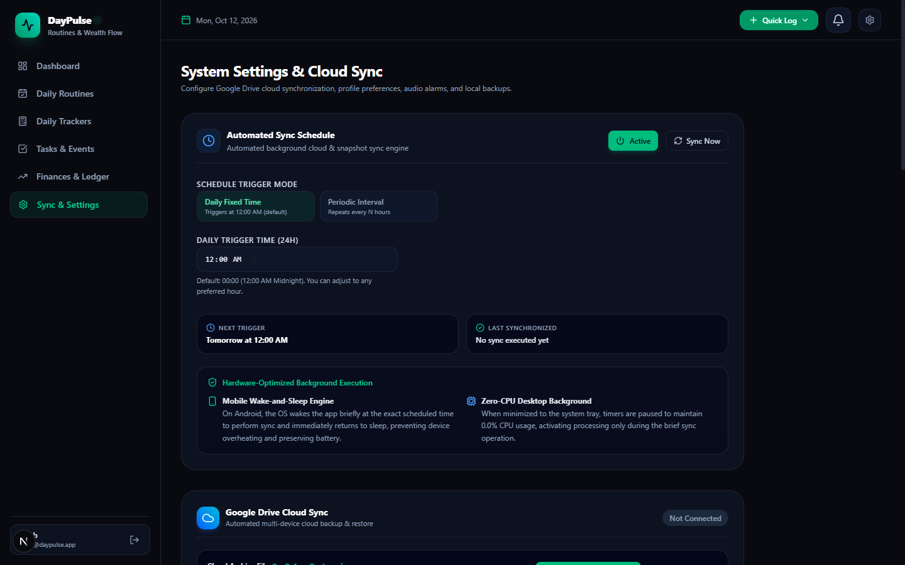
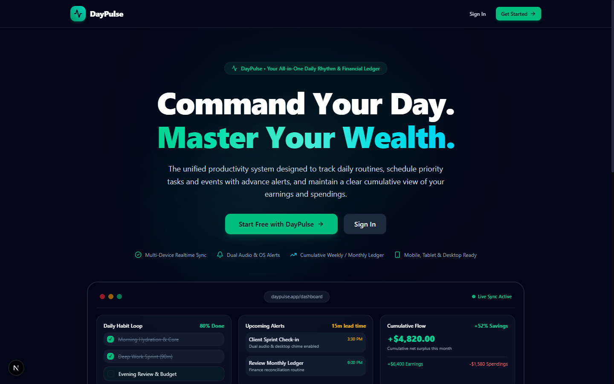

# DayPulse — Daily Activity Flow, Routine Mastery & Financial Pulse

<p align="center">
  
</p>

<p align="center">
  <strong>Cross-platform daily productivity, routine tracker, and cumulative financial ledger.</strong>
</p>

<p align="center">
  
  
  
  
  
  
  
  
</p>

---

## Application Showcase

### Main Workspace & Real-Time Dashboard


<br/>

### Core Features

| Routine Mastery & Habit Loops | Priority Task & Event Scheduler |
| :---: | :---: |
|  |  |
| **Habit Tracking & Streaks**<br/>Grouped by time slot (Morning, Afternoon, Evening) with advance alarm chime reminders. | **Precision Calendar & Priority Matrix**<br/>Discrete task/event classification with urgent/high/medium priorities and lead time warnings. |

| Cumulative Financial Pulse & Cashflow Ledger | Cross-Platform Local-First Onboarding |
| :---: | :---: |
|  |  |
| **Cumulative Spendings & Income Ledger**<br/>SVG trajectory charts, multi-currency support, itemized categories, and savings rate. | **Flexible Data Ownership**<br/>Restore from offline ZIP archive, Google Drive cloud sync, or create local accounts. |

| Cloud Sync & System Settings | Modern Landing Page |
| :---: | :---: |
|  |  |
| **Zero-Port Vault & Cloud Sync**<br/>Configure recurring sync intervals, AES-256 token vault, and multi-device dispatchers. | **Clean Presentation**<br/>Responsive design tailored for web, Electron desktop, and Capacitor Android mobile devices. |

---

## Architecture Overview

```
daily-task-tracker/ (Monorepo Workspace)
├── server/                     # Standalone Express + TypeScript + Socket.io Server
│   ├── src/
│   │   ├── config/             # Environment, JWT, Vault, and Google OAuth settings
│   │   ├── modules/
│   │   │   ├── auth/           # User registration, JWT login, profile management
│   │   │   ├── routine/        # Daily routines, streaks, and completion logs
│   │   │   ├── task/           # Tasks, events, priority scheduling, advance alerts
│   │   │   ├── finance/        # Ledger expenses/income & cumulative cashflow analytics
│   │   │   ├── sync/           # Google Drive OAuth, AES-256 token vault & single-file sync
│   │   │   └── socket/         # Socket.io real-time alarm engine & multi-device sync
│   │   ├── scheduler/          # 30-second recurring cron reminder & alarm dispatcher
│   │   ├── middlewares/        # JWT auth, Zod validation, global error handler
│   │   └── utils/              # AES-256-GCM cryptoVault, Google Drive v3 client, prisma
│   ├── prisma/                 # Prisma ORM schema & SQLite database (dev.db)
│   └── package.json            # Server dependencies (Express, Socket.io, Prisma, node-cron)
│
├── web-app/                    # Next.js 16 (React 19) App Router UI Client
│   ├── app/                    # Responsive application views (Landing, Dashboard, Routines, Tasks, Finances, Settings)
│   ├── components/             # Reusable UI widgets, modals, charts, dock, navbar
│   ├── lib/
│   │   ├── api-client.ts       # Unified API client attaching Bearer tokens
│   │   ├── socket-client.ts    # Socket.io client receiving server alarms & sync updates
│   │   ├── audio-chime.ts      # HTML5 Web Audio synthesized dual-tone harmonic chime
│   │   └── web-notification.ts # Native browser push notifications
│   └── package.json            # Frontend dependencies
│
├── desktop-app/                # Electron desktop client wrapper
└── android-app/                # Capacitor Android mobile client wrapper
```

---

## Core Capabilities

### 1. Daily Activity & Routine Loops
- Group daily habits by time slots: **Morning**, **Afternoon**, **Evening**, **Night**, and **Anytime**.
- Recurrence days configuration (Sunday through Saturday).
- Target completion times with proactive advance notifications.
- Streak engine with confetti celebration upon completion.

### 2. Task & Event Precision Scheduler
- Discrete separation between **Tasks** (action items) and **Events** (calendar engagements).
- Priority Matrix: **Low**, **Medium**, **High**, and **Urgent**.
- Due date/time tracking with overdue status indicators.
- Advance reminder lead times: 5m, 10m, 15m, 30m, 1h before deadline.

### 3. Cumulative Spendings & Earnings Ledger
- Daily transaction logging for **Spendings** (expenses) and **Earnings** (income).
- Itemized categories (Food & Dining, Housing & Utilities, Transport, Salary, Freelance, Investments).
- Multi-currency support: USD ($), EUR (€), GBP (£), BDT (৳), INR (₹), CAD, AUD, JPY.
- Interactive SVG trajectory chart tracking cumulative net flow.
- Period filters: **Weekly**, **Monthly**, and **Yearly** analysis.
- Automatic savings rate calculation (`(Income - Expenses) / Income * 100`).

### 4. Real-Time Alarm & Background Notification Engine
- **Persistent Server Scheduler**: Evaluates upcoming task deadlines and routine start times every 30 seconds and pushes alarms directly to connected clients over WebSockets.
- **Harmonic Audio Chime**: Synthesized dual-tone harmonic chime (C5/G5 harmonic sine waves) via HTML5 Web Audio API (works 100% offline, zero external audio assets required).
- **Native OS / Browser Push Notifications**: System-level notifications for deadlines and daily protocols.
- **In-App Notification Center**: Drawer tracking notifications with unread counts and quick audio toggles.

### 5. Google Drive Cloud Sync & Vault Security
- **AES-256-GCM Token Encryption**: Google OAuth access and refresh tokens are encrypted using AES-256-GCM with PBKDF2 key derivation and authentication tags before database persistence.
- **Targeted Single-File Overwrite**: Google Drive backups target and overwrite the existing `DayPulse_Backup.json` file rather than creating duplicate files on each sync.
- **Idempotent Upsert Restoration**: Restoring backups uses record-level upserts to ensure repeated imports never generate duplicate records.
- **Multi-Device Live Sync**: Database mutations trigger immediate WebSocket broadcasts to update all connected devices in real time.
- **Sandbox Simulation Mode**: Built-in test sandbox allows verifying cloud synchronization workflows locally without needing immediate Google Cloud credentials.

---

## Getting Started

### 1. Prerequisites
- Node.js 20+
- npm or bun

### 2. Installation
```bash
npm install
```

### 3. Database Setup (Server)
```bash
npm run db:push
```

### 4. Running the Development Stack
Run server (port 5000) and web app (port 3000):
```bash
# Terminal 1: Backend Server (Express + WebSocket + Scheduler)
npm run dev:server

# Terminal 2: Frontend Web App (Next.js UI)
npm run dev:web
```

Open [http://localhost:3005](http://localhost:3005) in your browser.

---

## Google Drive Cloud Sync Setup

DayPulse supports encrypted, single-file Google Drive backups for cross-device synchronization and data portability.

### Android Application
- **Zero Configuration Required**: Download the signed APK from releases and install.
- Native Google Play Services authentication is linked directly to the application package name (`com.daypulse.tracker`) and the release signature certificate SHA-1.
- Simply tap **Sync with Google Drive** inside the app and choose your Google account.

### Desktop Application & Self-Hosted Web Client
Because the desktop app is a decentralized, local-first client running on each user's computer, users configure their own Google OAuth credentials:

#### In-App Configuration (Recommended)
1. Open DayPulse Desktop and navigate to **Settings** -> **Google Drive Cloud Sync**.
2. Click **Configure Credentials** / **Enter Credentials**.
3. Paste your **Client ID** and **Client Secret**.
4. Click **Connect Google Drive** to authenticate via your local browser.

#### Environment File Configuration (Self-Hosted Developers)
Create or update your `.env` file in the project root:
```env
GOOGLE_CLIENT_ID="your-client-id.apps.googleusercontent.com"
GOOGLE_CLIENT_SECRET="your-client-secret"
GOOGLE_REDIRECT_URI="http://localhost:5000/api/v1/sync/google/callback"
```

#### Creating Your Google OAuth Credentials (for Desktop / Web)
1. Open [Google Cloud Console](https://console.cloud.google.com/) and create a project.
2. In **APIs & Services > Library**, search for and enable **Google Drive API**.
3. In **APIs & Services > OAuth consent screen**:
   - Choose **External** user type.
   - Add the scope `https://www.googleapis.com/auth/drive.file`.
   - Set publishing status to **In production** (or add your Gmail to test users).
4. In **APIs & Services > Credentials**:
   - Click **Create Credentials** -> **OAuth 2.0 Client ID**.
   - Select **Web application**.
   - Under **Authorized redirect URIs**, add: `http://localhost:5000/api/v1/sync/google/callback`.
5. Copy the generated **Client ID** and **Client Secret** into DayPulse Desktop Settings.
